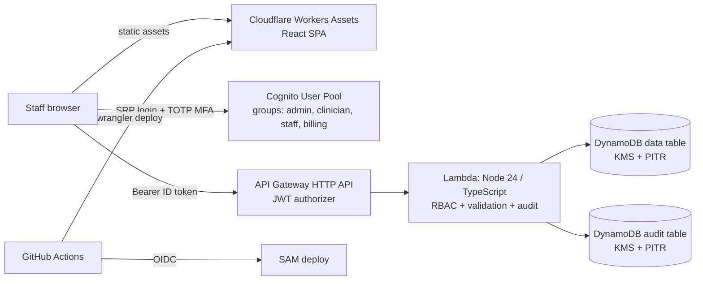
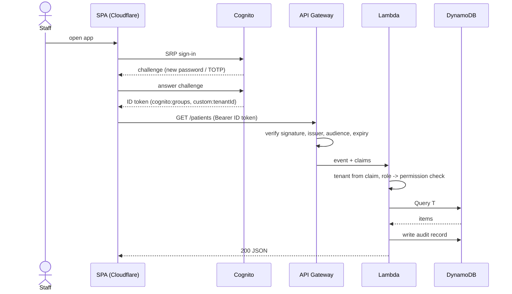

# Healthcare CRM on AWS + Cloudflare

A serverless, multi-tenant healthcare CRM reference implementation: Cognito user pools with role groups, an
authenticated HTTP API on Lambda, DynamoDB storage, and a React SPA hosted on Cloudflare. A GitHub Actions
workflow deploys it all using OIDC, with no long-lived AWS keys.

> **Status: reference architecture, not production-ready.** It has been typechecked and unit-tested (RBAC, the page-token
> guard and audit ordering) but never deployed or pen-tested, and it is not a certified compliance product. Read
> [docs/security.md](docs/security.md), including the known issues, before putting any real patient data near it.

## Architecture



## Sign-in and request flow



## Roles

| Permission | admin | clinician | staff | billing |
|---|:-:|:-:|:-:|:-:|
| Read patients / appointments | ✅ | ✅ | ✅ | ✅ |
| Write patients / appointments | ✅ | ✅ | ✅ | ❌ |
| Read / write outreach notes | ✅ | ✅ | ✅ | ❌ |
| Read clinical notes | ✅ | ✅ | ❌ | ❌ |
| Write clinical notes | ❌ | ✅ | ❌ | ❌ |

The matrix lives in `backend/src/lib/auth.ts` and is unit-tested.

## What is stored

| Table | Contents |
|---|---|
| `healthcare-crm-<stage>` | Patients (name, DOB, contact, status), interaction notes (`outreach` / `clinical`), appointments. Single-table design, keys prefixed `T#<tenantId>#`. |
| `healthcare-crm-audit-<stage>` | One record per API request: user, roles, action, outcome, patient ID, request ID, source IP. Never stores patient field values. |

User accounts live in Cognito, not DynamoDB.

## Layout

```
infra/template.yaml     SAM/CloudFormation: Cognito, KMS, DynamoDB x2, HTTP API, Lambda
backend/                TypeScript Lambda (router, handlers, RBAC, audit) + vitest
frontend/               Vite + React SPA, wrangler.jsonc for Cloudflare, CSP in public/_headers
docs/                   security notes and known issues, ADRs
.github/workflows/      test on PRs, deploy on main
```

## API

| Method | Path | Notes |
|---|---|---|
| GET / POST | `/patients` | list (paginated via `next`) / create |
| GET / PUT | `/patients/{id}` | read / update (409 if someone else changed the patient first) |
| GET / POST | `/patients/{id}/interactions` | `?kind=outreach\|clinical` on GET |
| GET / POST | `/appointments` | `?date=YYYY-MM-DD` (UTC day) on GET |

The UI currently has only sign-in and a patient list/add screen; appointments and notes exist in the API only.

## Getting started

Prerequisites: AWS account (with a BAA if you ever use real PHI), AWS CLI, SAM CLI, Node 24 (matches the Lambda runtime), a Cloudflare account.

```bash
# 1. Backend
cd backend && npm ci && npm test && cd ..
sam build -t infra/template.yaml
sam deploy --stack-name healthcare-crm-dev --guided   # set AllowedOrigin to your frontend URL

# 2. Create the first user (admin-only sign-up; tenantId is set here and is immutable)
POOL=<UserPoolId output>
aws cognito-idp admin-create-user --user-pool-id $POOL --username admin@clinic.example \
  --user-attributes Name=email,Value=admin@clinic.example Name=email_verified,Value=true Name=custom:tenantId,Value=clinic-001
aws cognito-idp admin-add-user-to-group --user-pool-id $POOL --username admin@clinic.example --group-name admin

# 3. Frontend (local)
cd frontend && cp .env.example .env   # fill from stack outputs
npm ci && npm run dev
```

First sign-in prompts for a new password, then TOTP enrolment, then a code.

**Deploying the frontend to Cloudflare:** use the CI workflow, which fills in the CSP origins for your API and Cognito
region. There is deliberately no local deploy script.

### CI/CD setup
Repo variables: `AWS_REGION`, `FRONTEND_ORIGIN`. Secrets: `AWS_DEPLOY_ROLE_ARN` (IAM role trusting GitHub OIDC,
restricted to this repo and the `production` environment), `CLOUDFLARE_API_TOKEN`, `CLOUDFLARE_ACCOUNT_ID`.
Create a `production` environment with required reviewers.

## Why DynamoDB and not SQL?
See [ADR 0001](docs/adr/0001-dynamodb-over-aurora.md): known access patterns, no VPC, tenant isolation by key prefix.
Choose Aurora PostgreSQL if reporting-heavy.

## Roadmap
Fix the [known issues](docs/security.md#known-issues), tenant-isolation tests, patient portal (second user pool),
appointment reminders (EventBridge + SES/SNS), FHIR export, WAF, per-tenant timezone.

## License
[MIT](LICENSE)
