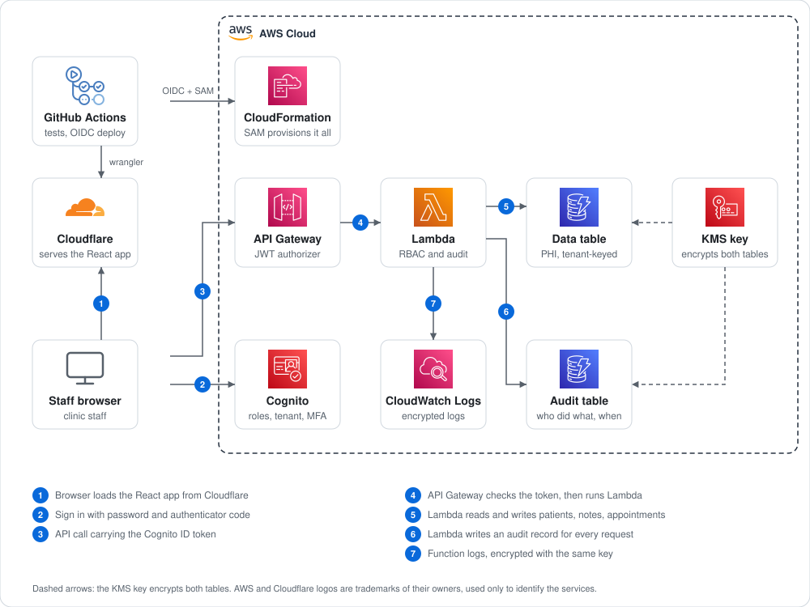

# cloud-templates

Production-minded templates for cloud services on AWS and Cloudflare. Each template is a self-contained project with
infrastructure as code, application code, tests, docs and its own CI/CD workflow, so you can copy one folder and
build on it.

> **Status:** reference templates. Read each template's `docs/security.md` before using it with real data. Nothing
> here is a compliance certification.

## Templates

| Template | What it is | Stack | Status |
|---|---|---|---|
| [`crm/healthcare`](crm/healthcare) | Multi-tenant healthcare CRM with role-based access and an audit trail | Cognito, API Gateway, Lambda, DynamoDB, KMS on AWS; React on Cloudflare; GitHub Actions | Reference architecture, never deployed |

<p align="center">
  
</p>

## Infrastructure building blocks

Reusable CloudFormation templates, each in its own folder under [`infra/`](infra) with its own README. A template
deploys the blocks it needs as separate stacks that find each other through a shared name prefix.

| Block | What it creates |
|---|---|
| [`kms-data-key`](infra/kms-data-key) | Encryption key for tables and logs, kept if the stack is deleted |
| [`dynamodb-table`](infra/dynamodb-table) | Encrypted DynamoDB table with recovery and an optional index |
| [`cognito-user-pool`](infra/cognito-user-pool) | Staff sign-in with mandatory MFA and an immutable tenant ID |
| [`http-api-jwt`](infra/http-api-jwt) | HTTP API that admits only valid Cognito tokens and calls one Lambda |
| [`github-oidc-role`](infra/github-oidc-role) | Deploy role for GitHub Actions, limited to one repo and environment |

How they fit together, and the deploy order, are in [`infra/README.md`](infra/README.md).

## How the repo is organised

```
<category>/<template>/
  infra/       infrastructure as code (SAM / CloudFormation)
  backend/     API code and tests
  frontend/    web app
  docs/        architecture, security notes, decision records
  README.md    how to deploy and use this template

.github/workflows/<category>-<template>.yml
               one CI/CD workflow per template; it runs only when that template's folder changes

infra/<block>/
  template.yaml  a reusable CloudFormation building block (key, table, user pool, API, ...)
  README.md      parameters, exports, how to deploy it
.github/workflows/infra.yml
               lints every block whenever something under infra/ changes
```

## Using a template

1. Copy the template folder (for example `crm/healthcare`) into your own repo.
2. Copy its workflow from `.github/workflows/` and update the paths in it.
3. Follow the template's own README to deploy.

## Adding a template

1. Create `<category>/<template>/` with the layout above.
2. Add `.github/workflows/<category>-<template>.yml`, with a `paths:` filter so it only runs for that folder.
3. Add a row to the table above.

## License

[MIT](LICENSE). AWS and Cloudflare logos in the diagrams are trademarks of their owners and are used only to identify
the services.
