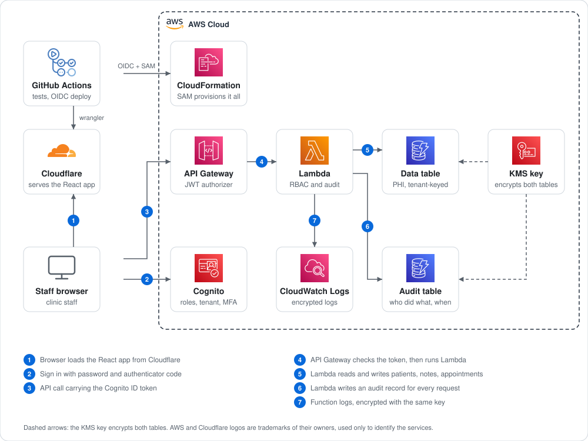
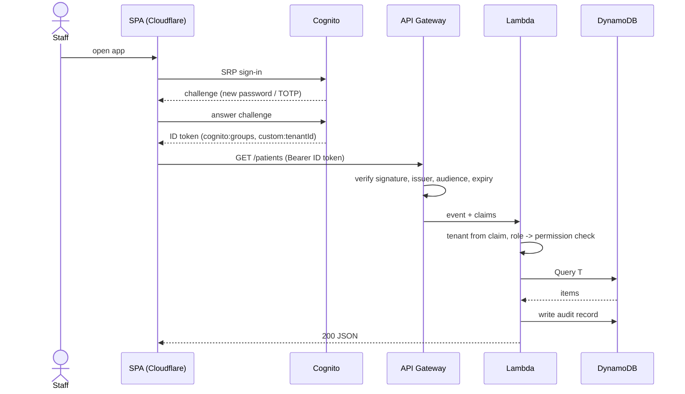

# Healthcare CRM on AWS + Cloudflare

A serverless, multi-tenant healthcare CRM reference implementation: Cognito user pools with role groups, an
authenticated HTTP API on Lambda, DynamoDB storage, and a React SPA hosted on Cloudflare. A GitHub Actions
workflow deploys it all using OIDC, with no long-lived AWS keys.

> **Status: reference architecture, not production-ready.** It has been typechecked and unit-tested (RBAC, the page-token
> guard and audit ordering) but never deployed or pen-tested, and it is not a certified compliance product. Read
> [docs/security.md](docs/security.md), including the known issues, before putting any real patient data near it.

## Architecture

<p align="center">
  
</p>

## Sign-in and request flow



## Roles

| Permission | admin | clinician | staff | billing |
|---|:-:|:-:|:-:|:-:|
| Read patients / appointments | ✅ | ✅ | ✅ | ✅ |
| Write patients / appointments | ✅ | ✅ | ✅ | ❌ |
| Read / write outreach notes | ✅ | ✅ | ✅ | ❌ |
| Read clinical notes | ✅ | ✅ | ❌ | ❌ |
| Write clinical notes | ❌ | ✅ | ❌ | ❌ |

The matrix lives in `backend/src/lib/auth.ts` and is unit-tested.

## What is stored

| Table | Contents |
|---|---|
| `<prefix>-data` | Patients (name, DOB, contact, status), interaction notes (`outreach` / `clinical`), appointments. Single-table design, keys prefixed `T#<tenantId>#`. |
| `<prefix>-audit` | One record per API request: user, roles, action, outcome, patient ID, request ID, source IP. Never stores patient field values. |

`<prefix>` is the deployment name you choose, for example `healthcare-crm-prod`.

User accounts live in Cognito, not DynamoDB.

## Layout

```
infra/                  CloudFormation stacks, one folder each: key, tables, user pool, API, app, deploy role
backend/                TypeScript Lambda (router, handlers, RBAC, audit) + vitest
frontend/               Vite + React SPA, wrangler.jsonc for Cloudflare, CSP in public/_headers
docs/                   security notes and known issues, ADRs, architecture diagram
```

Each folder under [`infra/`](infra) is a separate stack; see [`infra/README.md`](infra/README.md). The CI workflow is
`.github/workflows/healthcare-crm.yml` at the repo root: copy it along with this folder.

## API

| Method | Path | Notes |
|---|---|---|
| GET / POST | `/patients` | list (paginated via `next`) / create |
| GET / PUT | `/patients/{id}` | read / update (409 if someone else changed the patient first) |
| GET / POST | `/patients/{id}/interactions` | `?kind=outreach\|clinical` on GET |
| GET / POST | `/appointments` | `?date=YYYY-MM-DD` (UTC day) on GET |

The UI currently has only sign-in and a patient list/add screen; appointments and notes exist in the API only.

## Getting started

Prerequisites: AWS account (with a BAA if you ever use real PHI), AWS CLI, SAM CLI, Node 24 (matches the Lambda runtime), a Cloudflare account.

```bash
# 1. Tests
cd backend && npm ci && npm test && cd ..

# 2. Infrastructure: one stack per folder under infra/, all sharing one prefix (run from this template's folder)
PREFIX=healthcare-crm-dev
deploy() { name=$1; template=$2; shift 2; aws cloudformation deploy --stack-name "$PREFIX-$name" \
  --template-file "$template" --no-fail-on-empty-changeset --parameter-overrides ExportPrefix="$PREFIX" "$@"; }
deploy kms   infra/kms-data-key/template.yaml
deploy data  infra/dynamodb-table/template.yaml TableLabel=data Stage=dev EnableGsi=true
deploy audit infra/dynamodb-table/template.yaml TableLabel=audit Stage=dev
deploy auth  infra/cognito-user-pool/template.yaml
sam build -t infra/app/template.yaml
sam deploy --stack-name "$PREFIX-app" --resolve-s3 --capabilities CAPABILITY_IAM --parameter-overrides ExportPrefix="$PREFIX"
deploy api   infra/http-api-jwt/template.yaml AllowedOrigin=http://localhost:5173

# 3. Create the first user (admin-only sign-up; tenantId is set here and is immutable)
POOL=$(aws cloudformation describe-stacks --stack-name "$PREFIX-auth" \
  --query "Stacks[0].Outputs[?OutputKey=='UserPoolId'].OutputValue" --output text)
aws cognito-idp admin-create-user --user-pool-id $POOL --username admin@clinic.example \
  --user-attributes Name=email,Value=admin@clinic.example Name=email_verified,Value=true Name=custom:tenantId,Value=clinic-001
aws cognito-idp admin-add-user-to-group --user-pool-id $POOL --username admin@clinic.example --group-name admin

# 4. Frontend (local)
cd frontend && cp .env.example .env   # fill from the ApiUrl output of the api stack and the auth stack outputs
npm ci && npm run dev
```

First sign-in prompts for a new password, then TOTP enrolment, then a code.

**Deploying the frontend to Cloudflare:** use the CI workflow, which fills in the CSP origins for your API and Cognito
region. There is deliberately no local deploy script.

### Deploying (manual, with inputs)

Deploying never runs by itself. You start it by hand and type four inputs, so nothing needs to be stored in the repo
settings first:

| Input | Example | What it is |
|---|---|---|
| `aws_region` | `us-east-1` | Region where the AWS stacks are created |
| `frontend_origin` | `https://crm.example.com` | Web address of the app: https, no path. The only address allowed to call the API from a browser |
| `aws_deploy_role_arn` | `arn:aws:iam::123456789012:role/github-actions-deploy` | Role GitHub assumes to deploy. It is the `RoleArn` output of [`infra/github-oidc-role`](infra/github-oidc-role), limited to this repo and the `production` environment |
| `stack_prefix` | `healthcare-crm-prod` | Name shared by every stack of the deployment |

Two values cannot be typed in because they are secrets: `CLOUDFLARE_API_TOKEN` and `CLOUDFLARE_ACCOUNT_ID`. Add them as
repo secrets, and create a `production` environment with required reviewers.

Start it from the Actions tab (`healthcare-crm`, **Run workflow**), or from a terminal:

```bash
gh workflow run healthcare-crm.yml --ref main \
  -f aws_region=us-east-1 \
  -f frontend_origin=https://crm.example.com \
  -f aws_deploy_role_arn=arn:aws:iam::123456789012:role/github-actions-deploy \
  -f stack_prefix=healthcare-crm-prod
```

Until you do, the deploy job does not run. Pushes and pull requests only run the tests.

### Deploy with an AI agent

Fill in the four values and paste this into Claude Code or another coding agent:

```text
Deploy the healthcare CRM template with its manual deploy workflow.

Inputs (never guess one; ask me if any is missing):
- aws_region: <us-east-1>
- frontend_origin: <https://crm.example.com>
- aws_deploy_role_arn: <arn:aws:iam::123456789012:role/github-actions-deploy>
- stack_prefix: <healthcare-crm-prod>

Steps:
1. Read AGENTS.md and templates/healthcare-crm/AGENTS.md.
2. Check that the repo has the secrets CLOUDFLARE_API_TOKEN and CLOUDFLARE_ACCOUNT_ID and a "production"
   environment (gh secret list; gh api repos/{owner}/{repo}/environments). If anything is missing, stop and tell me.
3. Show me the exact gh workflow run command with my inputs and wait for my yes.
4. Run it on main and follow it with gh run watch. If it fails, read the failed step's log and tell me the cause.
   Do not retry or change anything without asking.
Never put a secret in this prompt or in the chat.
```

The workflow checks each input before it touches AWS, so a typo fails fast with a clear message.

## Why DynamoDB and not SQL?
See [ADR 0001](docs/adr/0001-dynamodb-over-aurora.md): known access patterns, no VPC, tenant isolation by key prefix.
Choose Aurora PostgreSQL if reporting-heavy.

## Roadmap
Fix the [known issues](docs/security.md#known-issues), tenant-isolation tests, patient portal (second user pool),
appointment reminders (EventBridge + SES/SNS), FHIR export, WAF, per-tenant timezone.

## License
[MIT](../../LICENSE)
